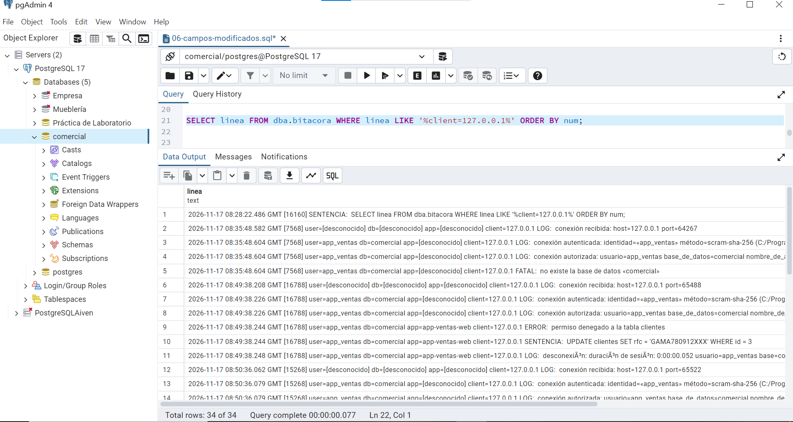

# LAB-01 — Bitácoras y auditoría del dato en PostgreSQL
_Gestión de seguridad y desempeño de bases de datos_

**Jesús Jared Recio Ozúa 4-3**

## Actividad 6 — Cambios de privilegios y de estructura

**¿Qué tipo de evento es cada una de las tres primeras sentencias (privilegio o estructura)?**
* `REVOKE UPDATE ON clientes FROM soporte_ana` es un evento de privilegio: le quita a soporte_ana el permiso de modificar clientes.
* `GRANT UPDATE ON clientes TO app_ventas` es un evento de privilegio: le da ese permiso a app_ventas.
* `ALTER TABLE clientes ADD COLUMN segmento VARCHAR(20)` es un evento de estructura: cambia la definición de la tabla.

**¿Por qué GRANT y REVOKE quedan registrados con log_statement = 'ddl'?**
PostgreSQL clasifica GRANT y REVOKE como DDL porque modifican el catálogo del sistema, donde se guardan las listas de privilegios de cada objeto. No son solo CREATE, ALTER y DROP. Por eso aparecen en la bitácora con fecha, usuario y cliente, lo que permite auditar cada cambio de permisos.

**Si la bitácora contiene contraseñas, ¿quién debería poder leerla? Relaciónalo con la gestión de secretos de la Unidad II.**
La bitácora debe tratarse como un secreto: solo debería leerla un rol de auditoría o administración, con permisos restringidos sobre la carpeta log y sin acceso para roles de aplicación. Esto se relaciona con la gestión de secretos de la Unidad II, ya que las contraseñas nunca deben escribirse en texto plano dentro de sentencias SQL.