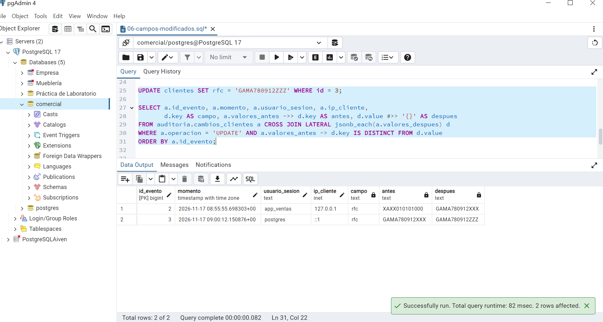
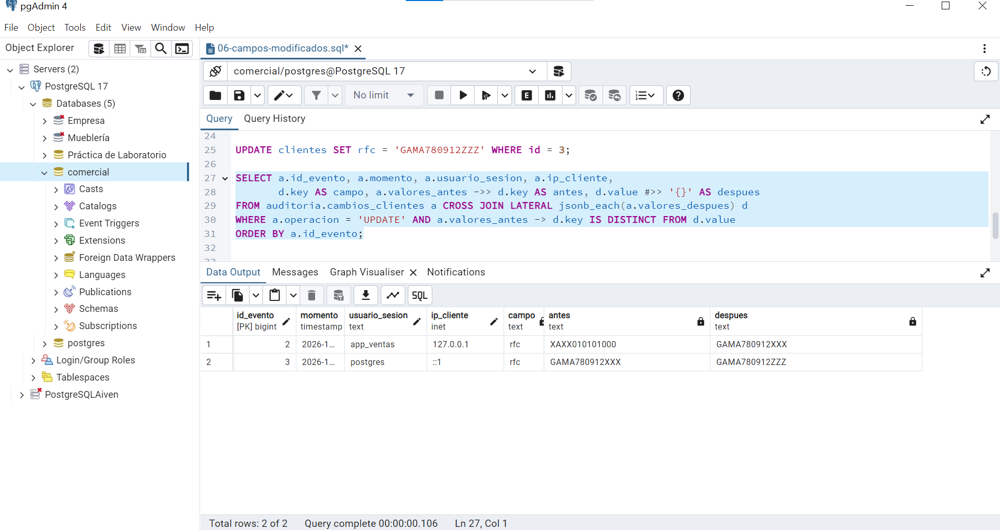

# LAB-01 — Bitácoras y auditoría del dato en PostgreSQL
_Gestión de seguridad y desempeño de bases de datos_

**Jesús Jared Recio Ozúa 4-3**

## Actividad 12 — El incidente auditado

 


**Compara tu hipótesis de la Actividad 11 con este resultado.**
Mi hipótesis era que, sin SECURITY DEFINER, el INSERT de la auditoría correría con los privilegios de app_ventas, fallaría con permission denied y cancelaría también el UPDATE. El resultado muestra el caso contrario, que es el real con SECURITY DEFINER: el UPDATE se ejecutó y el disparador guardó la fila con `usuario_sesion = app_ventas`, aunque app_ventas no tiene permiso sobre la tabla de auditoría.

**Escribe la sentencia UPDATE que restauraría el valor anterior.**
```sql
UPDATE clientes SET rfc = 'GAMA780912XYZ' WHERE id = 3;