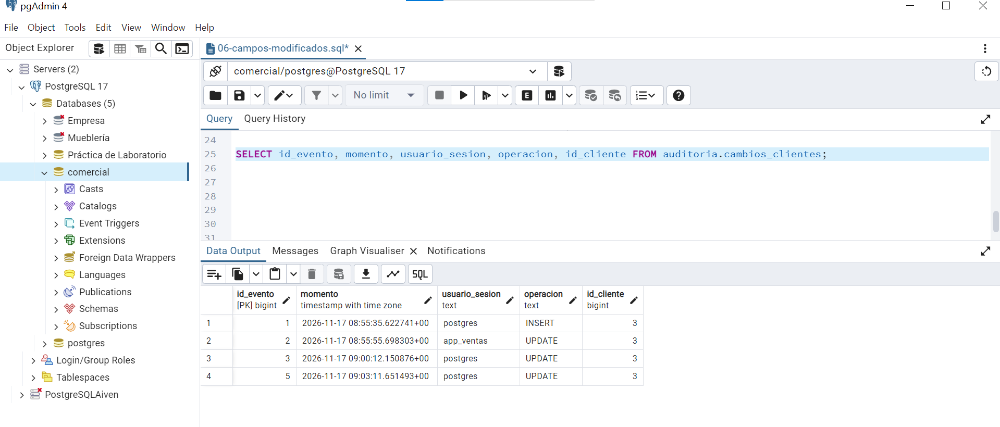

# LAB-01 — Bitácoras y auditoría del dato en PostgreSQL
_Gestión de seguridad y desempeño de bases de datos_

**Jesús Jared Recio Ozúa 4-3**

| # | Fecha y hora | Usuario | Cliente | Tipo de evento | Qué ocurrió | ¿Exitoso? | Fuente (línea o id_evento) |
| --- | --- | --- | --- | --- | --- | --- | --- |
| **1** | *2026-11-06 22:03:34* | `postgres` | `::1` | Privilegio | REVOKE UPDATE ON clientes FROM soporte_ana | Sí | Bitácora, PID 16008 |
| **2** | *2026-11-06 22:03:37* | `postgres` | `::1` | Privilegio | GRANT UPDATE ON clientes TO app_ventas | Sí | Bitácora, PID 16008 |
| **3** | *2026-11-06 22:03:39* | `postgres` | `::1` | Estructura | ALTER TABLE clientes ADD COLUMN segmento VARCHAR(20) | Sí | Bitácora, PID 16008 |
| **4** | *2026-11-06 22:04:10* | `postgres` | `::1` | Identidad / Secreto | CREATE ROLE rol_temporal LOGIN PASSWORD ... | Sí | Bitácora, PID 16008 |
| **5** | *2026-11-06 22:04:27* | `postgres` | `::1` | Identidad | DROP ROLE rol_temporal | Sí | Bitácora, PID 16008 |
| **6** | *2026-11-06 22:26:22* | `postgres` | `::1` | Identidad | DROP ROLE soporte_ana (rechazado por dependencias) | No | Bitácora, PID 20896 |
| **7** | *2026-11-06 22:59:11* | `app_ventas` | `127.0.0.1` | Modificación de dato | UPDATE del RFC del cliente 3 | Sí | Auditoría, id_evento 1 |
| **8** | *2026-11-06 23:20:28* | `postgres` | `::1` | Manipulación | Desactivación temporal del trigger y cambio manual | Sí | Bitácora, PID 14888 |

**Respuesta a las preguntas de Dirección:**
* **¿Quién cambió el RFC la primera vez (Actividad 3)? ¿Y en las Actividades 7, 12 y 14?** En la Actividad 3 no hay evidencia por falta de configuración. En la Act. 7 y 12 fue `app_ventas`. En la Act. 14 fue el administrador `postgres` tras desactivar el disparador.
* **¿Quién cambió el teléfono?** Atribuido al rol `app_ventas` mediante trazas de sentencia en el log.
* **¿Hubo intentos de acceso fallidos?** Sí, por parte de `app_ventas` debido a errores de contraseña (FATAL).
* **¿Qué valor tenía el RFC antes de cada cambio?** Inconmensurable al inicio por falta de bitácora; recuperado con exactitud matemática mediante la tabla de auditoría con JSONB en los eventos posteriores.